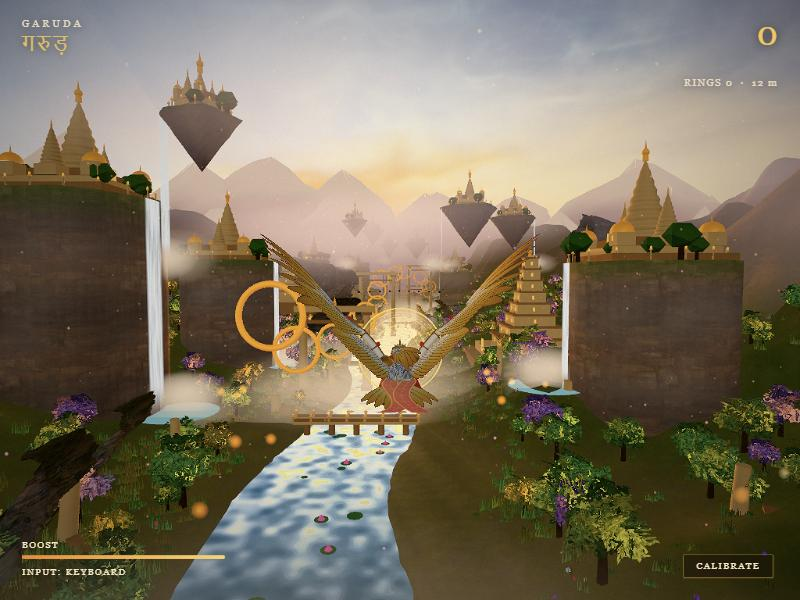

# Garuda — fly with a controller you build yourself



A browser flight game. You are **Garuda**, the divine eagle of Hindu mythology, soaring through a golden-hour valley of
temples, waterfalls, floating islands and glowing lamps. Fly through the gold rings, build combos, and switch to night.

**Play it:** https://rakshasriram03-svg.github.io/garuda-control/

It runs entirely in your browser — nothing to install. Play with:

| Input | How |
|---|---|
| **Keyboard** | Arrow keys / WASD to steer, **Space** to boost, **Z / X** to spin |
| **Gamepad** | Left stick or D-pad to steer, **A** or a trigger to boost, bumpers to spin |
| **DIY ESP32 tilt controller** | Tilt it to fly. Spin it to barrel-roll. See the build guide below |

> The USB controller uses the browser's Web Serial feature, which works in **desktop Chrome and Edge** only
> (not Firefox, Safari or phones). Keyboard and gamepad work anywhere.

## Keys

| Key | Action |
|---|---|
| **N** | Day / night |
| **V** / **T** | Front view / top view |
| **Q** | Change graphics quality (it also lowers itself if the game runs slowly) |
| **C** | Calibrate: hold the controller level and still |
| **K** | Calibrate tilt range: tilt fully in every direction for 4 s |
| **- / =** | Less / more sensitive |
| **U** | Swap roll and pitch (if your sensor is mounted sideways) |
| **R / I / Y** | Invert roll / pitch / spin |
| **G** | Show live controller numbers |

## Build the controller

**Parts:** an ESP32-S3 board, an MPU6050 (GY-521) module, 4 jumper wires, a USB data cable (optional: a push button for boost).

| MPU6050 | ESP32-S3 |
|---|---|
| VCC | 3V3 |
| GND | GND |
| SDA | GPIO 8 |
| SCL | GPIO 9 |
| Boost button (optional) | GPIO 4 to GND |

Use the **SDA** and **SCL** pads, not XDA / XCL. Solder the header pins — loose pins give intermittent readings.

1. In the Arduino IDE install **esp32 by Espressif** and choose the board **ESP32S3 Dev Module**.
2. Open [`firmware/garuda_controller/garuda_controller.ino`](firmware/garuda_controller/garuda_controller.ino) and upload it.
   If the Serial Monitor stays blank, flip *Tools → USB CDC On Boot* (Enabled for the native "USB" port, Disabled for the "UART" port).
3. Open the Serial Monitor at **115200**. You should see lines like `3.20,-1.10,0,0.4` (roll, pitch, button, spin).
   If it says `MPU6050 NOT FOUND`, the sketch searches every pin pair and tells you where the sensor is wired.
4. **Close the Serial Monitor** (only one program can use the port), open the game in Chrome or Edge, click **Connect controller (USB)**
   and pick your board. Hold it still while it calibrates, then fly.

The sketch streams `roll,pitch,button,spin` at 100 Hz using a complementary filter. Different sensor mounting? Press **U**, **R**, **I**
or **Y** in the game, or **K** to re-measure your tilt range. Settings are remembered in your browser.

## Run it locally

```
npm install
npm run dev
```

Build for production with `npm run build` (output in `dist/`). Pushing to `main` deploys to GitHub Pages through
the workflow in `.github/workflows/deploy.yml`.

## How it works

- **three.js** renders everything, with a real HDR sky, shadows, bloom, sun shafts and a grading pass tuned for OLED screens.
- The world streams procedurally: terrain with a river, temple towers, floating islands with waterfalls, stone bridges,
  lotus flowers, meadows, far snow peaks, birds and swans. Night adds lamps, sky lanterns and a moon.
- Garuda is built in code: layered textured feathers, a crown, jewellery and a mandala halo.
- Input is read with the Web Serial API and the Gamepad API.

## Credits

- Sky HDRIs, rock and lantern models and ground textures are **CC0** from [Poly Haven](https://polyhaven.com):
  `qwantani_sunset_puresky`, `qwantani_night_puresky`, `rock_face_01`, `namaqualand_cliff_01`, `boulder_01`,
  `brass_diya_lantern`, `aerial_grass_rock`, `cliff_side`.
- [three.js](https://threejs.org) (MIT).

## License

Code: MIT — see [LICENSE](LICENSE).
